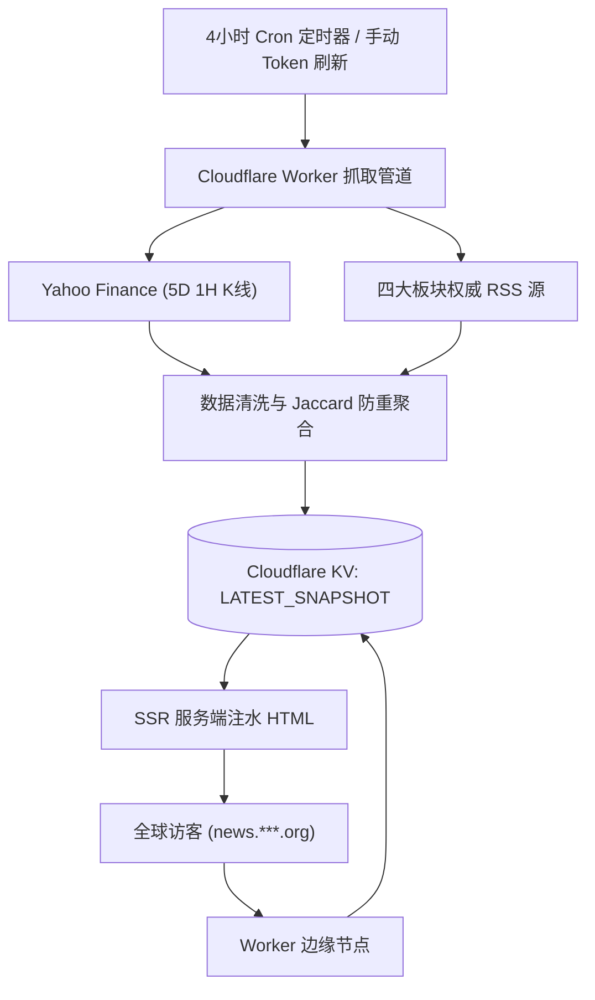
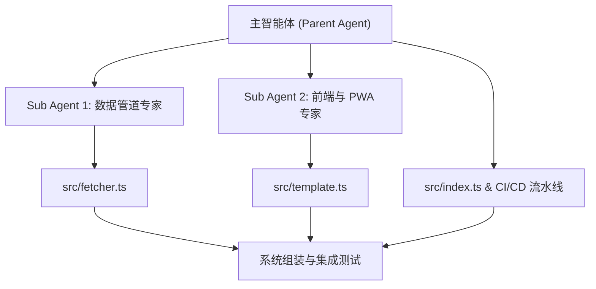

---
tags:
  - CloudflareWorkers
  - Serverless
  - TradingView
  - PWA
  - AIPairProgramming
  - Architecture
title: PulseTerminal开发笔记
category: Tech
published: 2026-10-17T09:06:01-07:00
image: https://image.heavenroad.org/default_cover.webp
slug: slug20261017090703
upload: false
---

## PulseTerminal 开发笔记

> [!abstract] 项目速览
> **PulseTerminal** 是一套运行于 Cloudflare Workers 边缘网络的无服务器（Serverless）全栈金融行情与新闻情报仪表盘。
> - **在线地址**：`https://news.***.org`（自定义域名已脱敏掩码）
> - **核心特色**：读写彻底分离（秒开首屏、零访问 API 消耗）、6 大核心资产与个人自选全 5 日 K 线图卡片、四大新闻板块 3 层智能跨源去重、全平台 PWA 沉浸体验、Token 鉴权与自动化 CI/CD。
> - **作者**：**Leo.H**

---

### 1. 为什么要做 PulseTerminal？

现代财经网站普遍存在三大痛点：
1. **视觉噪音过大**：满屏闪烁的广告、弹窗订阅、无关的八卦和分析师预测；
2. **加载缓慢与资源消耗**：打开一个简单页面往往加载数十个分析追踪器，消耗数十兆流量；
3. **新闻重复率畸高**：同一则重大经济或政治突发事件，各大报刊推文高度雷同，阅读效率极低。

我们需要的只是一台**高纯净度、高可读性、秒开级别**的态势感知终端：
一眼纵览标普 500、纳指、道指、黄金及主流加密资产的 5 天 1 小时走势与量价均线，同时获取经过智能过滤的权威新闻头条。



---

### 2. 交互 Prompt 演进与决策历程

整个项目采用 **AI 结对编程（Pair Programming）** 模式完成。从初始雏形到生产上线，经历了 13 次关键交互演进：

#### Prompt 历程复盘

| 阶段 | 用户指令 / 核心诉求 | 关键技术决策与落地 |
| :--- | :--- | :--- |
| **01. 确立标的与模式** | 补充 BTC/ETH/GLD；支持本地自选关注（可导出/导入）；4 小时 Cron 刷新；极度简洁无干扰风格；**强调“静态 Mockup 确认后再开发生产代码，生产代码严禁 Mock 数据”**。 | 确立两阶段开发规范；设计 `mockup/index.html` 交互原型与数据契约。 |
| **02. 安全与去重关切** | 加 Token 保护防刷；主要新闻聚焦美国经济、政治、科技、国际形势；担心多源重复；K 线横轴需要清晰日期刻度；中英双语；全自动 push 部署；保持文档最新并直接删除陈旧内容。 | 架构定为 `REFRESH_TOKEN` 鉴权；构思 3 层清洗算法（URL 规范化 + 媒体后缀剥离 + Jaccard 相似度）；引入 `deploy.yml` 自动化部署流水线。 |
| **03. 视觉与排版升级** | 字体太小，**增大 2 号**；每类新闻扩充至 20~50 条；移除主屏非必要说明，归纳至关于页面（About），标明作者 **Leo.H**。 | 全面提升基础字号（正文 16px，标题与代码 18-20px）；设计独立 About 模态框与版权说明入口。 |
| **04-06. 自选同构与 Agent 准则** | 询问是否有 `agent.md`；要求**个人自选标的也必须做成和 SPY 等大盘完全相同的 K 线图卡片**；字号再度调整。 | 编写 `agent.md` 固化为 AI 助手全局记忆红线；重构自选列表为同构 5D 1H K 线卡片。 |
| **07-08. 检索校验与合规** | 关于页面增加数据源与版权声明；个人自选标的需要支持输入联想检索与代码校验。 | 接入实时模糊匹配字典与 Yahoo 检索代理；建立严格正则与防重复校验；撰写数据源免责声明。 |
| **09-10. PWA 与并行提速** | 询问产出页面是否为 PWA；要求**尽可能利用 Sub Agent 并行开发以加快开发速度**。 | 引入 Web App Manifest 与 Service Worker；启动双 Sub Agent（数据管道 + 前端模板）并发落地。 |
| **上线与收尾** | 配置生产 KV 数据库、绑定自定义域名（如 `news.***.org`）、流水线锁文件报错修复、补充 Favicon。 | 解决 CI/CD 依赖构建、部署上线、制作专属脉搏 SVG 矢量 Favicon。 |
| **11. 中文标题与 Lazy AI 翻译** | 讨论语言切换为中文时英文标题的本土化问题；敲定 **Plan B 渐进式视口懒翻译**：无人看 0 消耗，按需视口懒翻译，KV 全局持久化缓存。 | 接入 Cloudflare Workers AI 专用翻译模型，实现前端视口异步请求与平滑淡入替换，文档先行、代码落地并同步博客。 |
| **12. 视口优先级与快照持久化回写** | 真实体验反馈：翻译全量并发慢（等待 8 秒）、全屏新闻同时突变、且刷新页面依然重复变中文的 Bug；设计并实施方案优化。 | 重构为视口头条（前 8~10 条）<1 秒优先快译，剩余后台平滑分块补齐；增加 `ctx.waitUntil` 异步回写 `LATEST_SNAPSHOT`，实现后续刷新 0 秒直出中文。 |
| **13. 发布 v0.1 与全栈性能遥测** | 打上 Git Tag `v0.1` 正式发布；在 About 页面内新增“系统各方面性能遥测分析看板”，记录最近 3 天各时段 API、RSS 耗时与 KV/AI 存储指标，为后续优化提供依据。 | 设计并实现边缘遥测管线，引入滚动 3 天历史、各大 API / RSS 单源响应耗时瀑布图、快照存储分析及实时网络测速探针，严格遵守零 Mock 数据红线。 |
| **14. 权威信源矩阵扩容与网络准入实测** | 针对信源单一问题展开深度调研与扩充，探索接入 WSJ, NYT, AP News, The Guardian, CNN, CBS 等顶级大报；更新规范文档、落地生产代码并同步博客。 | 严谨开展现场网络实测，剔除加挂 Turnstile 验证的 AP News、废弃的 Yahoo Finance RSS 与停更的 CNN；成功全量接入 NYT、The Guardian、CBS News、WSJ World 及 FT Global Economy 20+ 权威源矩阵；升级清洗正则与关于页面版权声明。 |
| **15. 5 维健康巡检 Skill 与 CI/CD 路径过滤优化** | 探讨站点健康度检查应该写成 Skill 还是写进 `agent.md`；要求落地全套健康巡检，并优化 Actions 部署流水线避免非代码变更触发重复部署。 | 确立“Skill 干重活、agent.md 记指针”的规范；在 `skills/site-health-check/` 交付 5 维自动化体检脚本；在 `.github/workflows/deploy.yml` 引入 `paths` 过滤机制，仅代码及核心配置变动才部署；同步更新技术规范与开发准则。 |

---

### 3. AI Agent 内部工程落地深度剖析

#### 3.1 严格的红线守则：零 Mock 与单一真实源
在 [`agent.md`](file:///Users/leovannys/github/cf-worker-news/agent.md) 中，我们锁定了两条核心红线：
1. **Zero Mock Data in Production**：生产代码（`src/` 目录下）决不允许出现任何硬编码的假数据或本地随机数生成器，必须全部通过网络抓取真实接口；
2. **Single Source of Truth**：需求发生变更时，直接修改/删除旧说明，绝不允许在文档中留下冲突的过时草稿。

#### 3.2 Sub Agent 并行协同实战
在 Phase 2 生产级代码开发中，主 Agent 负责全局架构设计，并并发派发了两个专家级 Sub Agent：



##### Sub Agent 1：数据管道与防封攻坚
- **攻克公共金融 API 的 429 限流**：
  在测试 Yahoo Finance 时，Sub Agent 1 发现直接请求时常遭遇 HTTP 429 限流。通过分析网络行为，它发现先向 `https://fc.yahoo.com` 发起探测可获取合法的会话 Cookie（`A3` Cookie）。Sub Agent 1 将此设计为**自动 Cookie 提取与 1 小时内存缓存机制**，不仅彻底攻克了限流，还配置了 `query1` 到 `query2` 的自动故障转移。
- **3 层新闻智能防重算法**：
  1. **URL 参数净化**：通过正则去除 `utm_*`, `ref`, `ocid`, `gclid` 等追踪参数比对唯一性；
  2. **媒体后缀清洗**：剥离如 ` - CNBC`, ` | Reuters`, ` - The Verge` 等各大媒体品牌后缀；
  3. **Jaccard 词元交并比相似度（Word Similarity）**：去除常用停用词后进行词元重叠度比对。若同一板块内相似度 $> 70\%$，自动认定为雷同新闻并保留最新条目，每类最终输出 20~50 条纯净资讯。

##### Sub Agent 2：前端 SSR 注水与 PWA 离线架构
- **TradingView Lightweight Charts v4.2.0**：
  在仅 210px 高度的紧凑卡片中，同时优雅呈现蜡烛图、天蓝色 SMA20 均线、底部成交量柱以及格式化横轴日期刻度（如 `10/14`、`10/16`）。
- **动态自选标的同构渲染**：
  用户在客户端添加的任意美股或加密货币标的，前端会按需异步调用 Worker 的 `/api/ticker?symbol=…` 接口，在客户端实时绘制同款专业 K 线图。
- **全站 PWA 标准**：
  配置 Standalone 独立应用模式、iOS 状态栏沉浸适配，并通过 Service Worker 对 Tailwind CDN 和 Lightweight Charts 库进行离线缓存，断网状态亦可浏览基础界面。

#### 3.3 Workers AI 渐进式视口懒翻译（Plan B 演进与落地）

在多语言体验演进中，针对“海外一手英文资讯如何在中文模式下优雅呈现”展开了深度探讨，并确立了最具克制美感且兼顾极致体验的 **Plan B 渐进式视口懒翻译模式**：
- **架构痛点**：
  1. 若在 4 小时 Cron 抓取时预先跑 AI 翻译，在无人访问期间会导致大模型算力空转；
  2. 若在访问时一次性全量请求并阻塞，不仅等待过久，而且全屏文字突兀跳变；
  3. 若仅缓存到独立 KV 键，用户刷新页面（F5）时 SSR 读出的依然是纯英文快照，客户端又会重复一次跳变（用户痛点 Bug）。
- **破局解法（Plan B 进阶优化）**：
  1. **后台 0 AI 消耗**：4 小时定时器抓取仅做清洗去重入库，不调用任何 AI；
  2. **英文模式 0 AI 消耗**：英文访客直读原生快照，毫秒级响应；
  3. **首屏视口优先分块（Viewport Priority Chunking）**：前端检测未翻译条目后，优先切片前 8 条首屏视口要闻立即请求（<0.8s 呈现），其余标题按 12 条/批在后台流水线式平滑静默拉取；
  4. **三级缓存体系（Three-tier Cache）**：
     - **L1 客户端 LocalStorage & 内存 Map**：刷新页面或标签页切换 0 延迟立现；
     - **L2 单条标题 KV 缓存**：以 `TR_{hash}` 独立持久化 14 天；
     - **L3 快照异步回写（Snapshot Write-back via `ctx.waitUntil`）**：翻译结果在后台异步合并写回 `LATEST_SNAPSHOT` 中的 `titleZh` 字段。一旦某篇新闻被翻译过一次，后续所有访客（及自身刷新）SSR 直出即为中文 HTML，0ms 等待，告别闪烁；
  5. **16 路并发扩容与平滑淡入**：Worker 端并发度提升至 16 并行，单条标题匹配 120ms 不变高度平滑淡入，彻底杜绝布局跳跃。

#### 3.4 边缘性能遥测与存储量化看板 (Telemetry & Performance Dashboard)

随着系统迭代至 `v0.1`，为了给下一步架构优化与边缘扩容提供扎实数据支撑，系统在 About 模态框内引入了 **全景性能与存储遥测分析** 功能：
- **严格遵循零 Mock 红线**：
  所有遥测数据（Latency、Payload Bytes、Deduplication Rate）均来自 Worker 实际抓取与处理时的精确时间戳（`performance.now()`）及 KV 字节计算，绝无虚构数据。
- **滚动 3 天流水线时序历史**：
  在 KV 中维护 `SYSTEM_TELEMETRY`，自动保留最近 3 天（约 25 次）定时与手动运行的历史详情。记录每次同步的触发源（Cron / Manual / Probe）、全链路耗时、快照体积（KB）及抓取收录条数。
- **单源耗时与健康态势矩阵**：
  - 核心行情源（Yahoo Finance, Twelve Data）：量化记录 SPY, QQQ, DIA, GLD, BTC-USD, ETH-USD 的单标的响应耗时与 K 线柱数；
  - 权威 RSS 媒体（Reuters, CNBC, WSJ, Bloomberg, FT, BBC, TechCrunch 等）：详细透视各大媒体服务器的网络延迟、原始抓取量与健康状态码。
- **Cloudflare 资源配额深度透视**：
  直观对比 KV 存储容量（当前 ~48KB / 免费上限 1GB，占用 <0.01%）、每日写操作（~18 次 / 免费上限 1,000 次，占用 1.8%）及 Workers AI 算力使用情况，保障系统长久安全运行在免费层级内。
- **实时网络测速探针 (Live Diagnostic Probe)**：
  提供 `GET /api/telemetry?probe=1` 实时探测接口。用户可在前端一键触发现场测速，1~2 秒内现场展示全球各大源服务器的最新响应速度。

#### 3.5 权威媒体信源矩阵扩容与反爬准入攻坚 (Premier News Matrix Expansion)

为了进一步丰富国际视野，提升四大板块（经济、政治、科技、国际）的新闻厚度与权威度，系统启动了对全球顶级媒体公开 RSS 接口的专项调研与实测准入：

##### 1. 严格的网络实测与淘汰机制
坚持“零假数据、零无效源”原则，Agent 对候选媒体进行了现场网络探测与解析验证：
- **准入源（实测 200 OK 且解析规范）**：
  - **The New York Times (NYT)**：4 大分类全覆盖（Business, Politics, Technology, World），平均响应 400~600ms，每类提供 30~50 篇深度一手报道。
  - **The Guardian (卫报)**：覆盖 US Politics, Tech 与 World News，XML 结构严谨且更新极其频繁。
  - **CBS News**：MoneyWatch 与 Politics 表现亮眼，提供高质量的美国国内经济与白宫动向。
  - **The Wall Street Journal (WSJ)**：通过 Dow Jones 公开聚合节点（`feeds.content.dowjones.io`）稳定接入 World News 核心外电。
  - **Financial Times (FT)**：通过 `ft.com/global-economy?format=rss` 接入全球宏观经济权威分析。
- **淘汰源（反爬阻断与失效源）**：
  - **AP News (美联社)**：官方前端已全面挂载 Cloudflare Turnstile 人机验证，第三方请求直接返回 `403 Forbidden`，不适宜作为无服务器后台 RSS 数据源。
  - **CNN**：官方公开 RSS 事实上已被出版方废弃，条目停留于 2023 年历史存档，甚至出现 `<title/>` 空标签。
  - **Yahoo Finance RSS**：原 `/news/rssindex` 接口已彻底报废（返回 `404 Not Found`），已果断剔除。

##### 2. Cloudflare Workers 子请求配额精算
Cloudflare Workers 免费层级对单次事件触发的外部子请求（Subrequests）限制为 **50 次**。
在扩容后：
- 6 大核心行情资产 API：6 次子请求；
- 四大新闻板块 23 个权威 RSS 源（经济 5 源、政治 6 源、科技 6 源、国际 6 源）：23 次子请求；
- **全链路单次总请求仅 29 次**，宽裕地运行在 50 次安全阈值之内（占用仅 58%），完全无超限风险。

##### 3. 3 层智能防重与标题清洗协同升级
随着信源数增加至 20+，同一突发事件（如美联储议息会议）被多家媒体报道的概率显著上升。3 层智能防重体系展现出强大威力：
- 升级媒体后缀清洗正则，全面剥离 `- The New York Times`、`| The Guardian`、`- CBS News`、`- The Wall Street Journal`、`| Financial Times`；
- Jaccard 词元相似度算法（$>70\%$ 阈值）精准剔除雷同推文，每类最终稳定沉淀 20~50 条最具代表性的高权重头条。

#### 3.6 5 维站点健康巡检 Skill 与 CI/CD 路径过滤双重进化

随着系统逐渐成长为具备 23 个全球顶级新闻源、6 大资产行情、大模型边缘快译与性能遥测的成熟系统，运维与部署流水线迎来了两项关键进化：

##### 1. 架构哲学演进：“Skill 干重活，agent.md 记指针”
在面对“站点健康度检查应该写成 Skill 还是写进 `agent.md`”这一架构命题时，我们确立了规范与技能解耦的最佳实践：
- **`agent.md` 严守“宪法原则”**：仅保留核心红线、项目定位和技能索引指针，避免将数百行探测逻辑和判定阈值塞入全局记忆导致上下文严重膨胀；
- **Skill 承接“工程化执行力”**：在 `skills/site-health-check/` 建立专门技能包，不仅定义清晰的触发条件，还打包了现成的 Node.js 探测脚本（`health_check.mjs`）。无论何时用户要求“检查站点健康”，Agent 都可以一键执行现场探测，从 **首屏 SSR、快照时效、23 源探针、微服务连通性与免费配额水位** 5 大维度输出结构化诊断报告。

##### 2. CI/CD 部署流水线路径过滤（Path Filtering）优化
此前，只要向 GitHub `main` 分支执行 `git push`，无论修改的是正文代码还是仅仅更新了 `README.md`、开发博客或原型，GitHub Actions 都会被全量触发并调用 Cloudflare Wrangler 重新部署。
针对这一资源浪费痛点，我们在 `.github/workflows/deploy.yml` 引入了精准的路径过滤机制：
```yaml
on:
  push:
    branches:
      - main
    paths:
      - 'src/**'
      - 'wrangler.toml'
      - 'package.json'
      - 'package-lock.json'
      - 'tsconfig.json'
      - '.github/workflows/deploy.yml'
```
- **立竿见影的效果**：
  1. **纯文档提交零部署**：撰写或补充 Markdown 规范、博客文章、原型页面与技能库时，CI 自动静默跳过，不再进行任何无效构建；
  2. **边缘无感稳定**：避免频繁向 Cloudflare Workers 边缘推包引发的无谓冷重启，显著节省 GitHub Actions 构建分钟数配额。

---

### 4. 架构优势总结

> [!tip] 核心架构优势
> 1. **极致秒开**：通过读写分离架构，用户的每次访问（`GET /`）直接由边缘 KV 单键注水输出 HTML，平均响应时间进入毫秒级，且消耗第三方 API 的配额为 0。
> 2. **完全免运维**：无需租用 Linux VPS，不需要配置 Nginx、PM2 或 MySQL。所有算力分布于 Cloudflare 全球数百个边缘数据中心。
> 3. **算力克制 (Frugal AI Architecture)**：通过 Plan B 视口懒翻译设计，无人看 0 消耗，按需视口翻译，将免费边缘大模型额度（10,000 Neurons/天）的利用效率提升到极致。
> 4. **安全受控**：`POST /api/refresh` 手动全量同步接口受 `REFRESH_TOKEN` 私密口令保护，无惧恶意爬虫刷爆配额。
> 5. **自动化闭环**：本地修改代码推送至 GitHub `main` 分支后，GitHub Actions 在 30 秒内全自动编译并发布至全球边缘节点。

---

### 5. 项目元信息与致谢

- **系统代号**：PulseTerminal
- **项目仓库**：`git@github.com:***/***/cf-worker-news.git`（私有路径脱敏）
- **线上站点**：`https://news.***.org`（自定义域名已脱敏）
- **项目作者**： livingfree2023@outlook.com
- **开发工具**：Antigravity + Google DeepMind Agentic Coding Framework

*本文档基于 Obsidian Markdown 语法编写，支持 Callouts、Mermaid 图表及双链笔记。*
